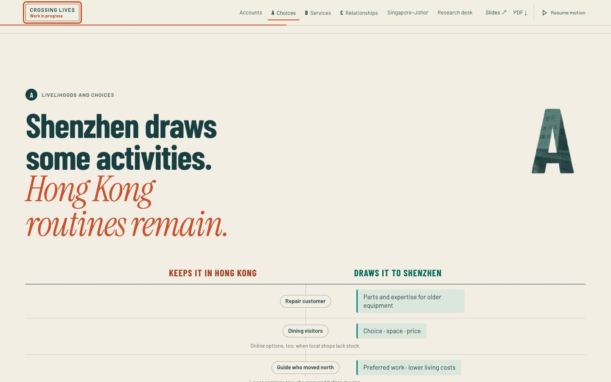
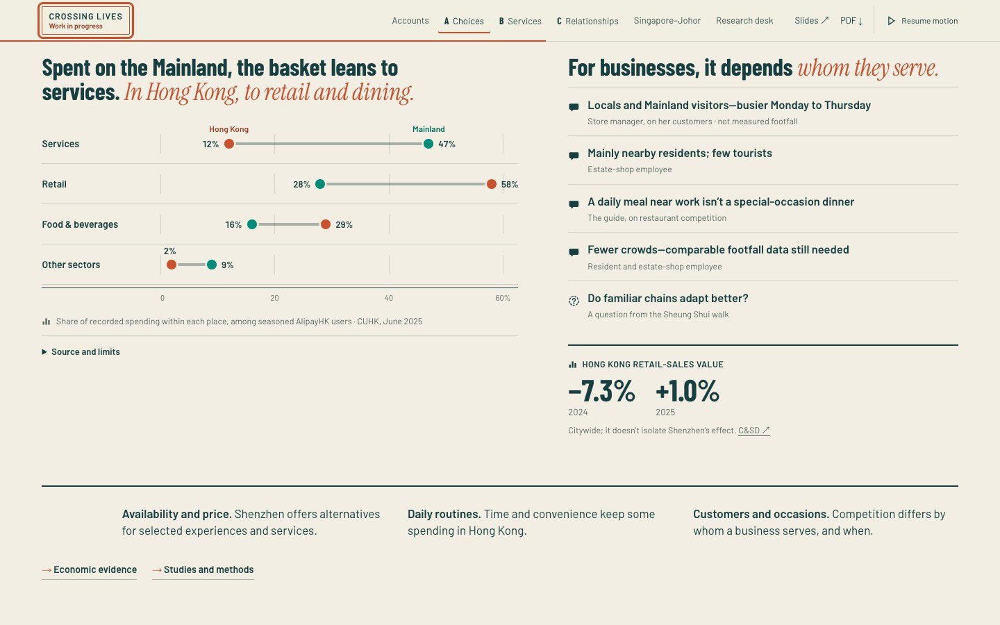
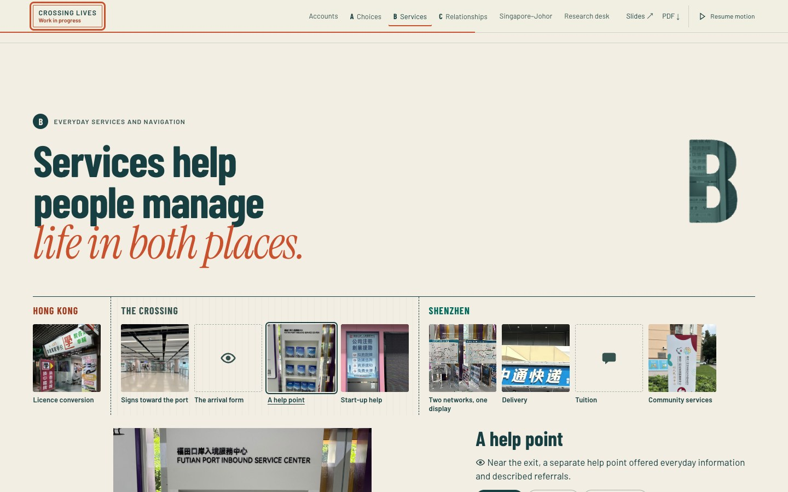
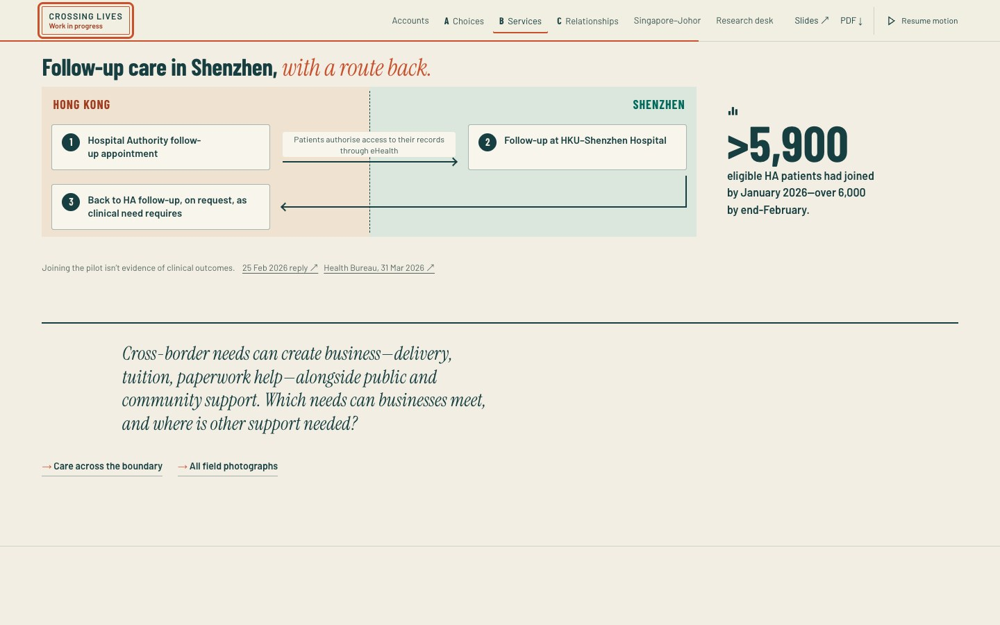
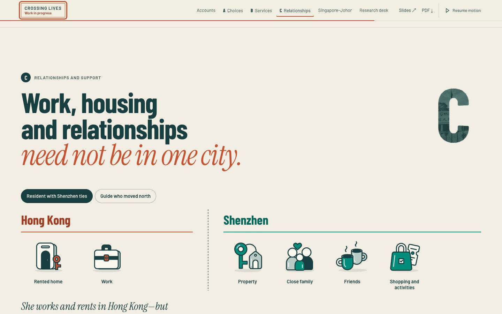
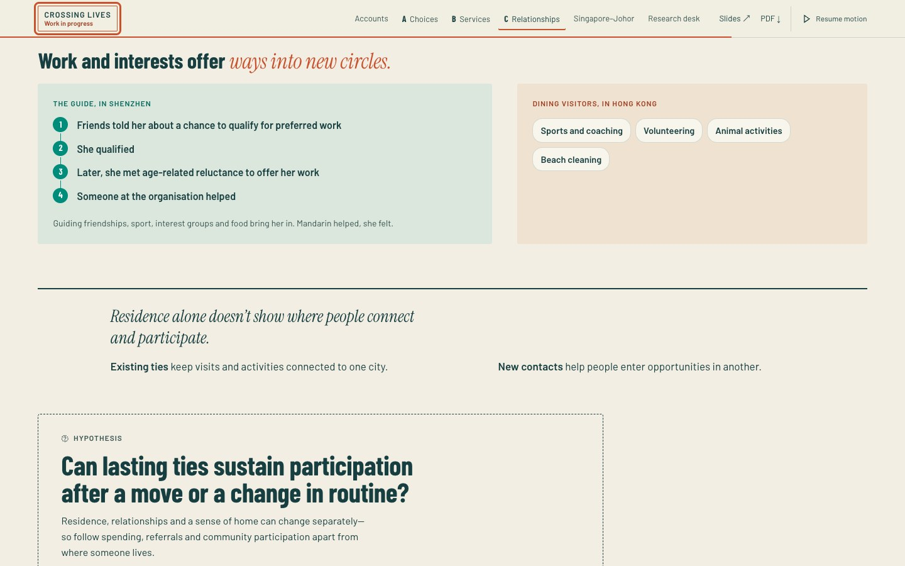
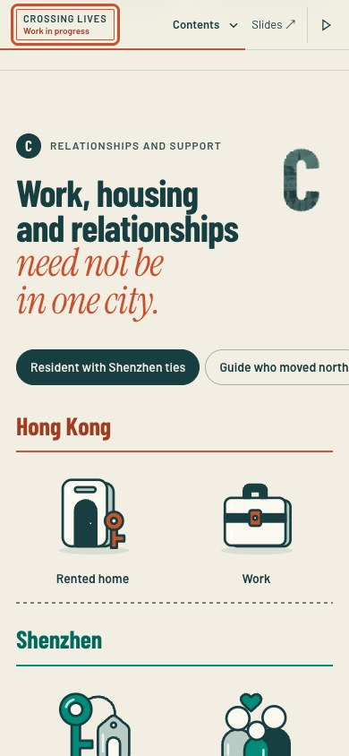

# Current website: review captures

Captured from the live GitHub Pages edition at main `008d77b`, 6 November 2026 (Hong Kong). These are the current implementation, not proposed redesigns.

Chrome 157.0.8103.38; desktop 1440×900, phone viewport 390×844; DPR 1; reduced motion. The phone capture is browser emulation, not a physical phone. Captures are viewport slices after scrolling to the relevant component; they do not demonstrate motion. The WIP popup was acknowledged for inspection.

[Return to the Opus handoff](../OPUS-WEBSITE-DIRECTION-20261106.md).

## A · reasons, default state

## A · spending comparison and business accounts

## B · service trail, default state

## B · care loop

## C · resident profile

## C · new circles and hypothesis

## C · phone viewport, resident profile

