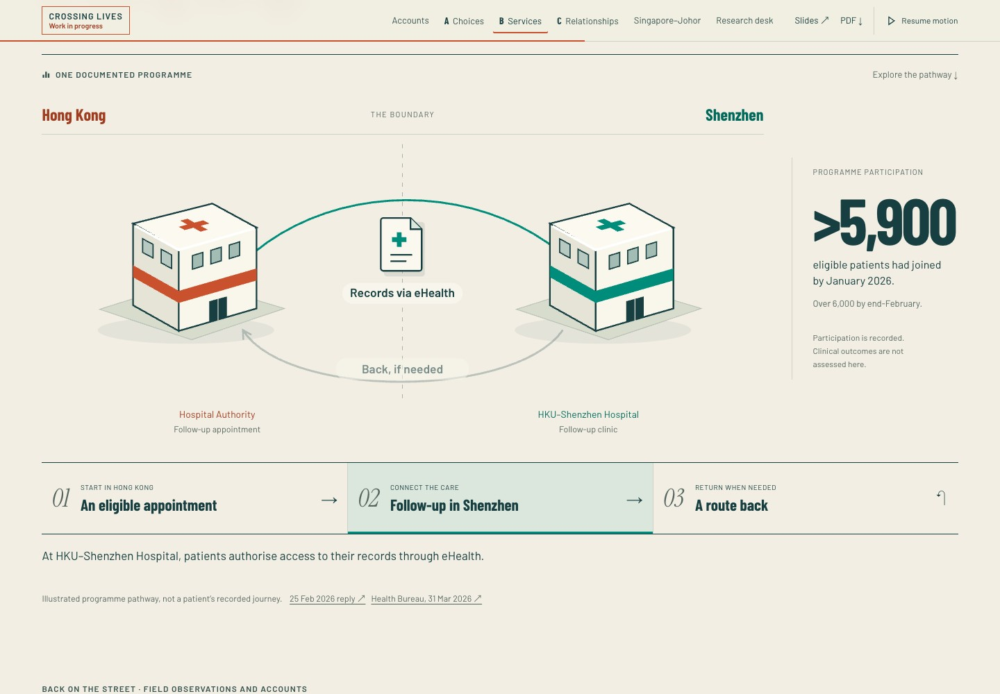
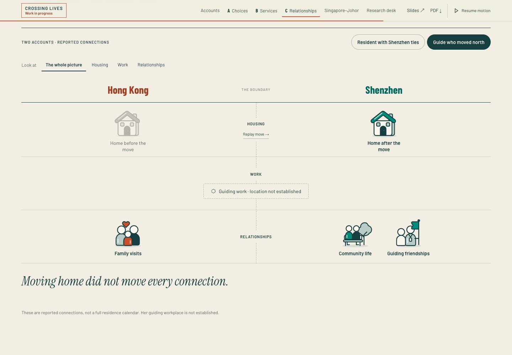
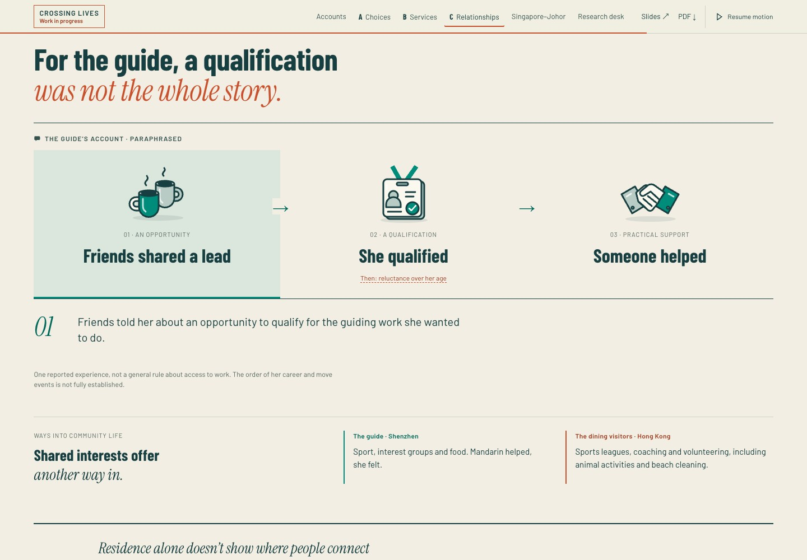

# Crossing Lives · archived candidate for Bob

**Branch:** `codex/connected-lives-20261106` · **runtime checkpoint:** `451ea2f` · **base main:** `008d77b`.

**Archive note, 8 November:** the preview and earlier visual studies are now pinned to `snapshot/` at public baseline `ebad522`. They preserve the previous interactions without restoring them to the current website. Presentation links lead to the current files. `snapshot/provenance.json` records the original file hashes.

Website only. Bob approved merging and publishing on 7 November 2026; [PR #1](https://github.com/bobshenruililin/jamie-crossing-lives-site/pull/1) records the merge status. This package preserves the pre-publication review captures. The presentation and PDFs are unchanged. The first-visit Work in progress notice remains.

## Try the archived candidate

From the repository root:

```sh
python3 -m http.server 4188 --bind 127.0.0.1
```

Open **[the interactive review](http://127.0.0.1:4188/review/connected-20261106/)** or [the full website](http://127.0.0.1:4188/). The review has four scenes, a phone-width switch and before/candidate controls. Its preview runs a frozen November 6 copy in `snapshot/`; acknowledge the Work in progress notice first. “Before” is a captured image, not a second running version.

## What to look for

1. **Care across the border.** Follow the three steps. The diagram shows eligible follow-up care, records with permission and a conditional route back. B now opens with this documented mechanism before the field photographs.
2. **Parts of a life.** Replay the guide's home move; family visits remain. Focus on housing, work or relationships, then switch to the resident. The rows stay fixed and unknown locations remain unplaced.
3. **A useful contact.** Follow the reported sequence from a lead to qualification, a barrier and practical help. The guide's experience stays distinct from the dining visitors' community examples.
4. **Questions that travel.** Select a Singapore–Johor question to see the earlier observation behind it and return to that lens. Published context and forecasts retain their status.

The main creative choice to review is B's care-first opening. Does the immediately visible mechanism earn the later arrival of the photographs? C's stable rows and guide-first order are similarly provisional. Research meaning is preserved; these compositions are proposals for Bob, not Jamie-approved revisions.

## Screenshots and interaction recordings

Actual Chrome captures, 6 November 2026. Desktop 1440 × 1000; phone-emulated 390 × 844, DPR 1. Screenshots use reduced motion; recordings use normal motion and actual clicks. These are not physical-device tests.

| Scene | Desktop | Phone | Interaction |
| --- | --- | --- | --- |
| Care pathway | [View](assets/care-desktop.jpg) | [View](assets/care-phone.jpg) | [Watch WebM](assets/care-interaction.webm) |
| Guide's connections | [View](assets/connections-desktop.jpg) | [View](assets/connections-phone.jpg) | [Watch WebM](assets/connections-interaction.webm) |
| Resident comparison | [View](assets/resident-desktop.jpg) | [View](assets/resident-phone.jpg) | Included in connections recording |
| Contacts and work | [View](assets/contacts-desktop.jpg) | [View](assets/contacts-phone.jpg) | Try scene 03 in the review |
| Field photographs | [View](assets/fieldwork-desktop.jpg) | [View](assets/fieldwork-phone.jpg) | Open the website's photo details |
| Johor questions | [View](assets/johor-desktop.jpg) | [View](assets/johor-phone.jpg) | Try scene 04 in the review |







## Checkpoints and limits

- Implementation: `451ea2f`, with **99/99 checks on each website entry point** (`/` and `/feature/`).
- Review package: **13/13 motion, touch and capture checks**, plus **22/22 review-page checks**, including video decoding and actual iframe interactions.
- Earlier isolated visual studies: **23/23 checks**, after repairing their cache-version mapping. No experimental proposal was adopted.
- Captures record their source revision, timestamp, browser and checks in [manifest.json](assets/manifest.json). The [before manifest](assets/before-manifest.json) records the public-site capture separately.
- Physical phones, Safari, Firefox, screen-reader testing and Jamie's review remain outstanding. The website's optional GPU renderer was not revalidated in this pass.
- The separate private source has not been ported; its older exporter must not overwrite this candidate. Raw research and participant identifiers remain private.

See [design rationale, evidence boundaries and rerun commands](../../docs/CONNECTED-EDITION-20261106.md).
